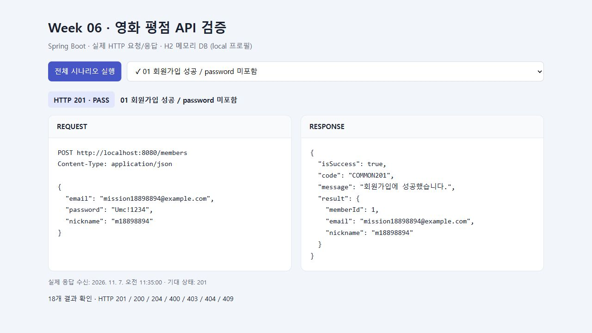
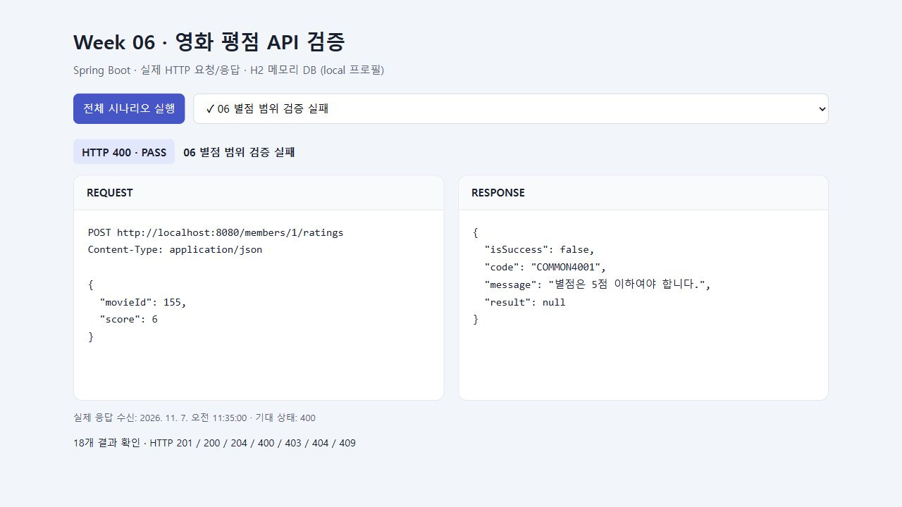
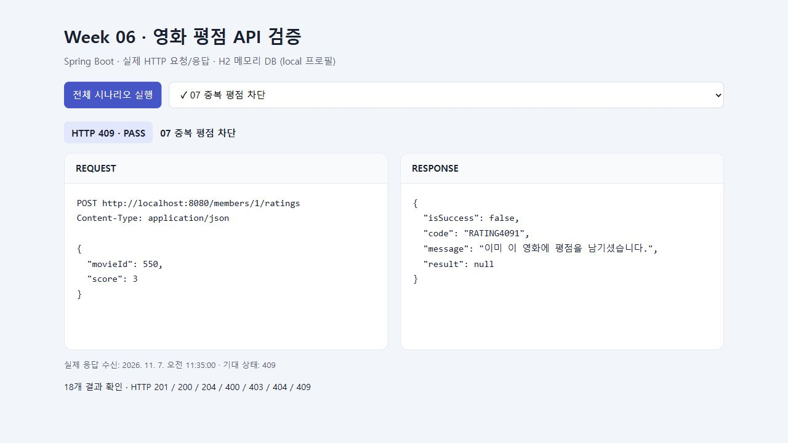
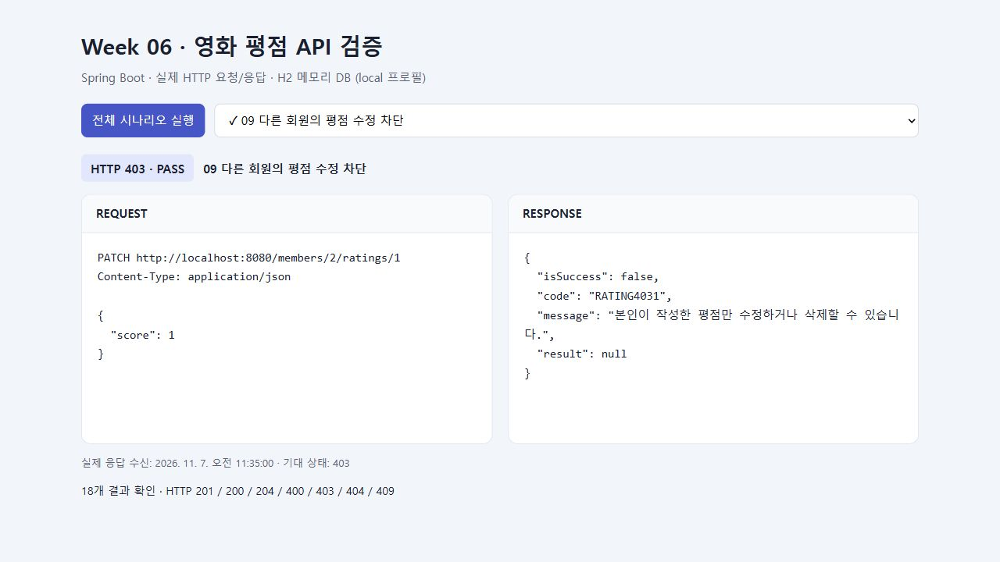
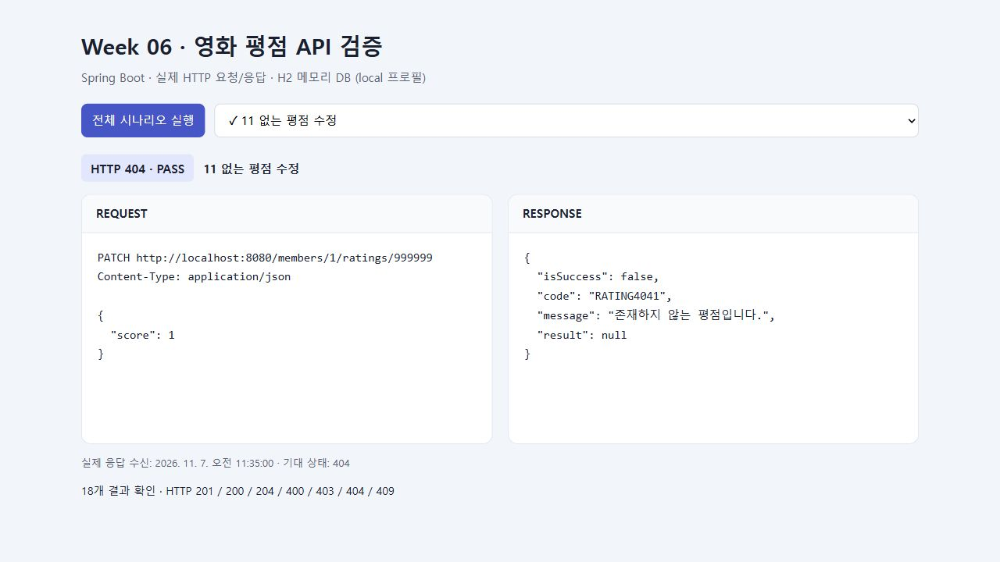
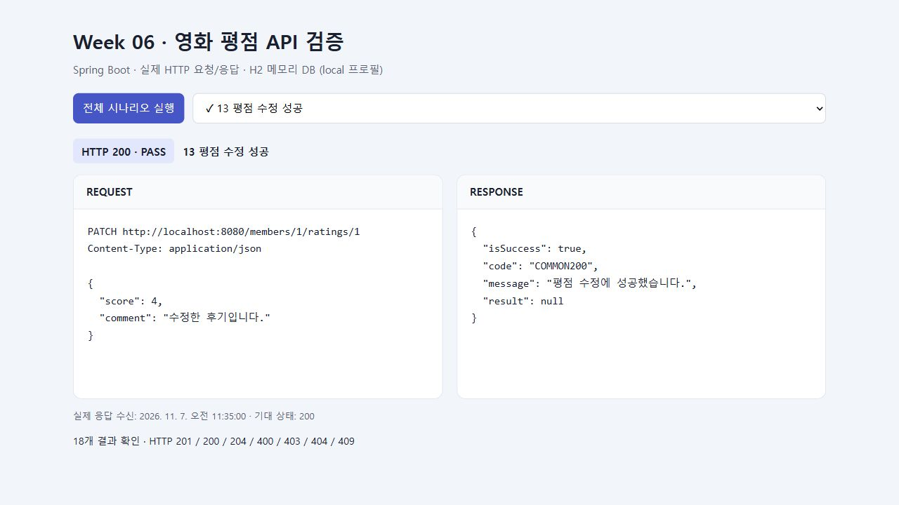
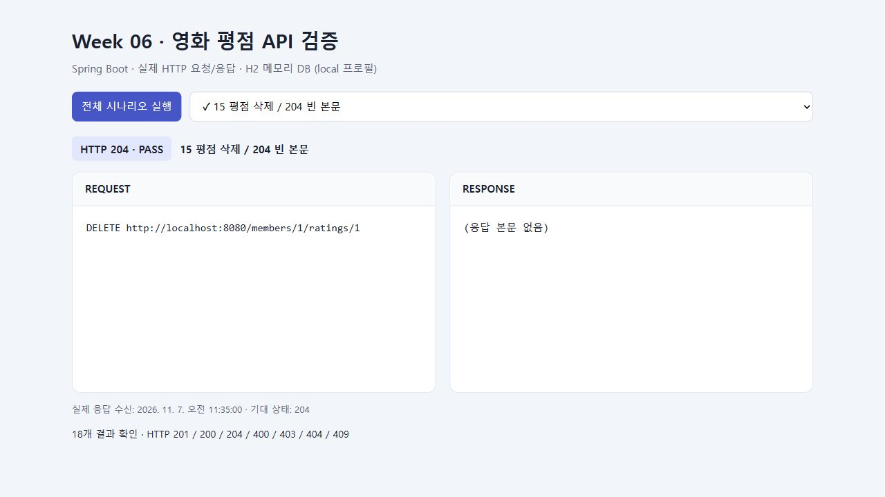
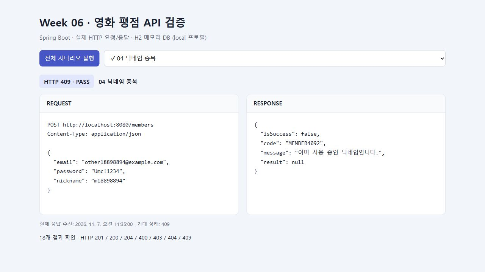
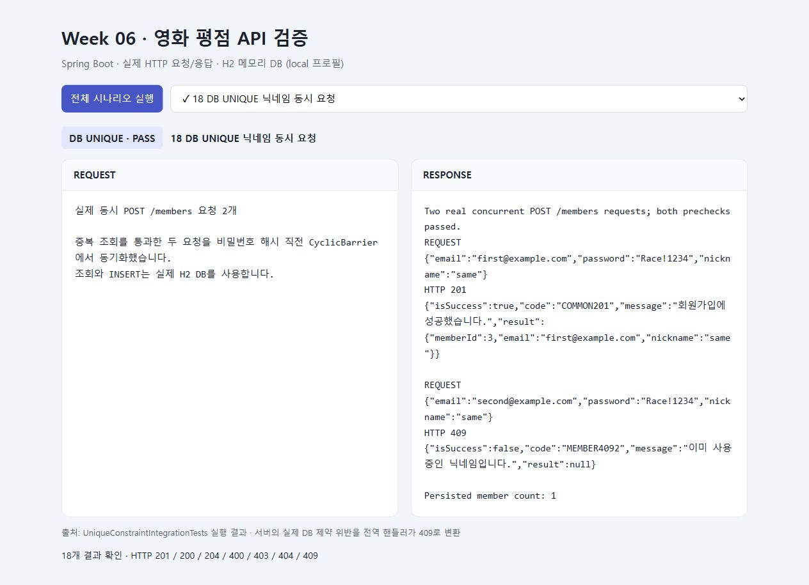

# 6주차 백엔드 미션 기록

영화 평점 서비스의 회원가입과 평점 등록·수정·삭제 API를 구현했다. 각 구현 단계에 실제 코드 발췌와 서버의 요청·응답 캡처를 함께 기록했다.

- 선택 스택: **Spring Boot 4.1.2, Java 21, Spring Data JPA**
- 입력 검증: Bean Validation
- 비밀번호 저장: bcrypt
- 검증 DB: H2의 MySQL 호환 모드
- 작업 브랜치: `week06`
- 검증일: 2026-11-07 (한국 시간)
- 구현 범위: Standard Mission + Challenge Mission

[API 명세](api-spec.md) · [실행 방법](../README.md)

아래 코드는 구현 파일에서 발췌했다. 캡처는 테스트용 example.com 계정으로 실제 API를 호출한 결과이며, 동시성 항목은 통합 테스트에서 생성한 원본 응답을 표시한 화면이다.

## 1. 구현할 API와 처리 흐름 정리

5주차 조회 API에 다음 쓰기 API를 추가했다. 기존 닉네임·이메일 중복 조회와 회원별 평점 조회 경로는 유지했다.

| 기능 | Method | 경로 | 성공 상태 |
| --- | --- | --- | --- |
| 회원가입 | POST | `/members` | 201 Created |
| 평점 등록 | POST | `/members/{memberId}/ratings` | 201 Created |
| 평점 수정 | PATCH | `/members/{memberId}/ratings/{ratingId}` | 200 OK |
| 평점 삭제 | DELETE | `/members/{memberId}/ratings/{ratingId}` | 204 No Content |

```text
JSON 요청
→ Controller의 @Valid로 DTO 검증
→ Service에서 중복·존재 여부·소유권 확인
→ Repository를 통해 DB에 저장·수정·삭제
→ 응답 DTO 또는 전역 예외 핸들러로 결과 반환
```

## 2. 회원가입 요청 DTO에서 입력값 검증

이메일은 필수·이메일 형식, 닉네임은 2~12자, 비밀번호는 영문 대문자·소문자·숫자·특수문자를 포함한 8자 이상으로 검증했다. bcrypt에 전달할 비밀번호는 UTF-8 기준 72바이트 이하로 제한했다. Controller에서 `@Valid @RequestBody SignUpRequest`를 받아 DTO 검증을 실행한다.

코드: [SignUpRequest.java](../src/main/java/com/umc/movie/dto/SignUpRequest.java)

```java
public record SignUpRequest(
        @NotBlank(message = "이메일을 입력해주세요.")
        @Email(message = "올바른 이메일 형식이 아닙니다.")
        @Size(max = 254, message = "이메일은 254자 이하로 입력해주세요.")
        String email,

        @NotBlank(message = "비밀번호를 입력해주세요.")
        @Pattern(regexp = "^(?=.*[a-z])(?=.*[A-Z])(?=.*\\d)(?=.*[!@#$%^&*]).{8,}$",
                message = "비밀번호는 대문자/소문자/숫자/특수문자를 포함한 8자 이상이어야 합니다.")
        @Utf8ByteLength(max = 72, message = "비밀번호는 UTF-8 기준 72바이트 이하여야 합니다.")
        String password,

        @NotBlank(message = "닉네임을 입력해주세요.")
        @Size(min = 2, max = 12, message = "닉네임은 2자 이상 12자 이하로 입력해주세요.")
        String nickname
) {}
```

**확인: 잘못된 이메일을 전송하면 저장 전에 400이 반환된다.** 응답의 `message`에는 검증 실패 이유가 들어간다.


## 3. 회원가입 저장과 비밀번호 응답 제외

회원가입 Service는 이메일과 닉네임 중복을 먼저 확인한다. 중복이 없으면 `PasswordEncoder.encode`로 bcrypt 해시를 저장한다. 저장한 엔티티 전체를 반환하지 않고 `MemberResponse`에 회원 ID·이메일·닉네임만 담아 응답한다.

코드: [MemberService.java](../src/main/java/com/umc/movie/service/MemberService.java) · [PasswordConfig.java](../src/main/java/com/umc/movie/config/PasswordConfig.java) · [MemberResponse.java](../src/main/java/com/umc/movie/dto/MemberResponse.java)

```java
public MemberResponse signUp(SignUpRequest request) {
    if (memberRepository.existsByEmail(request.email())) {
        throw new ApiException(ErrorCode.DUPLICATE_EMAIL);
    }
    if (memberRepository.existsByNickname(request.nickname())) {
        throw new ApiException(ErrorCode.DUPLICATE_NICKNAME);
    }
    Member member = Member.builder()
            .email(request.email())
            .password(passwordEncoder.encode(request.password()))
            .nickname(request.nickname())
            .build();
    Member saved = memberRepository.saveAndFlush(member);
    return new MemberResponse(saved.getMemberId(), saved.getEmail(), saved.getNickname());
}
```

**확인: 정상 가입은 201 Created를 반환하며 응답에 password가 없다.** bcrypt 저장 여부는 통합 테스트에서 해시 길이 60과 `PasswordEncoder.matches`로 확인했다.



## 4. 성공과 실패의 공통 응답 구조

쓰기 API의 성공·실패 응답은 `isSuccess`, `code`, `message`, `result` 구조를 사용한다. 검증 실패는 전역 예외 핸들러에서 400과 실패 메시지로 변환한다. DELETE 성공은 워크북의 약속대로 본문 없이 204를 반환한다.

코드: [ApiResponse.java](../src/main/java/com/umc/movie/dto/ApiResponse.java) · [GlobalExceptionHandler.java](../src/main/java/com/umc/movie/controller/GlobalExceptionHandler.java)

```java
public record ApiResponse<T>(boolean isSuccess, String code, String message, T result) {
    public static <T> ApiResponse<T> created(String message, T result) {
        return new ApiResponse<>(true, "COMMON201", message, result);
    }

    public static <T> ApiResponse<T> ok(String message, T result) {
        return new ApiResponse<>(true, "COMMON200", message, result);
    }

    public static ApiResponse<Void> failure(String code, String message) {
        return new ApiResponse<>(false, code, message, null);
    }
}
```

**검증 실패 처리 코드**

```java
protected ResponseEntity<Object> handleMethodArgumentNotValid(
        MethodArgumentNotValidException exception, HttpHeaders headers,
        HttpStatusCode status, WebRequest request) {
    String message = exception.getBindingResult().getFieldErrors().stream()
            .map(error -> error.getDefaultMessage())
            .findFirst().orElse("입력값을 확인해주세요.");
    return new ResponseEntity<>(ApiResponse.failure("COMMON4001", message), headers, status);
}
```

## 5. 평점 등록 및 입력값 검증

`movieId`는 TMDB 영화의 양의 정수 ID로 받으며 별도 movie 테이블을 참조하지 않는다. `score`는 필수인 1~5 정수이고, 선택 입력인 `comment`는 최대 500자다.

코드: [CreateRatingRequest.java](../src/main/java/com/umc/movie/dto/CreateRatingRequest.java) · [RatingService.java](../src/main/java/com/umc/movie/service/RatingService.java)

```java
public record CreateRatingRequest(
        @NotNull(message = "영화 ID를 입력해주세요.")
        @Positive(message = "영화 ID는 양수여야 합니다.")
        Long movieId,

        @NotNull(message = "별점을 입력해주세요.")
        @Min(value = 1, message = "별점은 1점 이상이어야 합니다.")
        @Max(value = 5, message = "별점은 5점 이하여야 합니다.")
        Integer score,

        @Size(max = 500, message = "후기는 500자 이하로 입력해주세요.")
        String comment
) {}
```

저장 시 회원이 존재하는지 확인하고 같은 회원·영화의 평점이 있는지 조회한다. 중복이 없으면 평점을 저장하고 생성된 `ratingId`를 반환한다.

```java
public Long create(Long memberId, CreateRatingRequest request) {
    Member member = memberRepository.findById(memberId)
            .orElseThrow(() -> new ApiException(ErrorCode.MEMBER_NOT_FOUND));
    if (ratingRepository.existsByMember_MemberIdAndMovieId(memberId, request.movieId())) {
        throw new ApiException(ErrorCode.DUPLICATE_RATING);
    }
    Rating rating = Rating.builder().member(member).movieId(request.movieId())
            .score(request.score()).comment(request.comment()).build();
    return ratingRepository.saveAndFlush(rating).getRatingId();
}
```

**확인: 정상 평점 등록은 201과 ratingId를 반환한다.**


**확인: 별점 6점을 전송하면 400으로 거절한다.**



**확인: 같은 회원이 같은 영화에 다시 등록하면 409를 반환한다.** 통합 테스트에서 실패 후에도 해당 평점이 한 건만 저장되어 있는지 확인했다.



## 6. 평점 수정·삭제와 소유자 확인

수정·삭제 전에 평점을 조회한다. 평점이 없으면 404, 평점의 작성자와 요청 경로의 `memberId`가 다르면 403을 반환한다. 두 API가 같은 검사를 사용하도록 `findOwnedRating`으로 묶었다.

코드: [RatingService.java](../src/main/java/com/umc/movie/service/RatingService.java)

```java
private Rating findOwnedRating(Long ratingId, Long memberId) {
    Rating rating = ratingRepository.findById(ratingId)
            .orElseThrow(() -> new ApiException(ErrorCode.RATING_NOT_FOUND));
    if (!rating.getMember().getMemberId().equals(memberId)) {
        throw new ApiException(ErrorCode.RATING_FORBIDDEN);
    }
    return rating;
}
```

**확인: 다른 회원의 ID로 평점을 수정하면 403을 반환한다.** 삭제도 동일하게 403을 반환하고 기존 데이터가 유지되는지 테스트했다.



**확인: 존재하지 않는 ratingId로 수정하면 404를 반환한다.** 삭제에서도 같은 결과를 확인했다.



소유권 검사를 통과하면 별점과 후기를 변경한다. `@Transactional` 안에서 관리되는 엔티티이므로 트랜잭션이 끝날 때 변경 감지로 저장된다.

```java
@Transactional
public void update(Long ratingId, Long memberId, UpdateRatingRequest request) {
    Rating rating = findOwnedRating(ratingId, memberId);
    rating.update(request.score(), request.comment());
    // 영속 상태 엔티티이므로 트랜잭션 종료 시 변경 감지로 UPDATE 됩니다.
}
```

**확인: 수정 요청은 200을 반환한다.** 이후 GET 조회와 통합 테스트에서 변경된 별점·후기를 확인했다.



삭제 Controller는 서비스 처리가 완료되면 `noContent()`로 빈 응답을 만든다.

코드: [RatingController.java](../src/main/java/com/umc/movie/controller/RatingController.java)

```java
public ResponseEntity<Void> delete(@PathVariable Long memberId, @PathVariable Long ratingId) {
    ratingService.delete(ratingId, memberId);
    return ResponseEntity.noContent().build();
}
```

**확인: 삭제 요청은 204이고 응답 본문이 없다.** 삭제 후 같은 회원의 평점 목록을 조회했을 때 빈 배열 `[]`이 반환되는 것도 확인했다.



## 7. 선택 미션: 이메일·닉네임 중복 오류 구분

회원가입의 사전 중복 검사에서 이메일 중복과 닉네임 중복을 구분하여 서로 다른 code와 message를 반환했다.

| 상황 | HTTP | code | message |
| --- | --- | --- | --- |
| 이메일 중복 | 409 | MEMBER4091 | 이미 사용 중인 이메일입니다. |
| 닉네임 중복 | 409 | MEMBER4092 | 이미 사용 중인 닉네임입니다. |

**확인: 이메일 중복 응답**


**확인: 닉네임 중복 응답**



## 8. 선택 미션: DB UNIQUE 제약 위반 처리

사전 중복 조회와 실제 INSERT 사이에 다른 요청이 저장될 수 있다. 따라서 서비스의 조회와 함께 DB UNIQUE 제약으로 중복 저장을 막는다. 전역 핸들러는 DB 제약 이름에 따라 이메일·닉네임·평점 중복 응답을 구분한다.

코드: [GlobalExceptionHandler.java](../src/main/java/com/umc/movie/controller/GlobalExceptionHandler.java) · [Member.java](../src/main/java/com/umc/movie/entity/Member.java) · [Rating.java](../src/main/java/com/umc/movie/entity/Rating.java)

```java
public ResponseEntity<ApiResponse<Void>> handleDataIntegrity(DataIntegrityViolationException exception) {
    // 사전 조회와 INSERT 사이의 경쟁 상태도 DB의 이름 붙은 UNIQUE 제약으로 구분합니다.
    for (Throwable cause = exception; cause != null; cause = cause.getCause()) {
        if (cause instanceof ConstraintViolationException violation) {
            String name = violation.getConstraintName();
            if (name == null) continue;
            name = name.toLowerCase(Locale.ROOT);
            if (name.contains("uk_member_email")) return failure(ErrorCode.DUPLICATE_EMAIL);
            if (name.contains("uk_member_nickname")) return failure(ErrorCode.DUPLICATE_NICKNAME);
            if (name.contains("uk_rating_member_movie")) return failure(ErrorCode.DUPLICATE_RATING);
        }
    }
    return failure(ErrorCode.DATA_CONFLICT);
}
```

동시성 테스트에서는 서로 다른 스레드의 가입 요청 두 건이 모두 사전 중복 조회를 통과한 뒤, 비밀번호 해시 직전 `CyclicBarrier`에서 만나도록 했다. 해시는 실제 bcrypt를 사용하며 Repository 조회와 INSERT도 실제 H2 DB에서 수행했다.

테스트 코드: [UniqueConstraintIntegrationTests.java](../src/test/java/com/umc/movie/UniqueConstraintIntegrationTests.java)

```text
요청 A: 중복 조회 통과 → INSERT 성공 → 201
요청 B: 중복 조회 통과 → DB UNIQUE 위반 → 409
최종 DB 저장 회원 수: 1명
```

**확인: 이메일 UNIQUE 충돌 — 201 한 건, MEMBER4091 한 건**


**확인: 닉네임 UNIQUE 충돌 — 201 한 건, MEMBER4092 한 건**



원본 기록: [이메일 동시 요청](evidence/db-unique-email.txt) · [닉네임 동시 요청](evidence/db-unique-nickname.txt)

## 9. 최종 검증 결과

```powershell
.\gradlew.bat test bootJar
```

실행 결과: **BUILD SUCCESSFUL, 테스트 32개 통과**

| 테스트 | 건수 | 실패 |
| --- | ---: | ---: |
| MissionApiIntegrationTests | 28 | 0 |
| UniqueConstraintIntegrationTests | 3 | 0 |
| MovieApplicationTests | 1 | 0 |
| 합계 | 32 | 0 |

입력값 검증, bcrypt 저장, 평점 CRUD의 실제 저장 결과, 중복 차단, 소유권, 없는 데이터, 5주차 조회 API 호환을 확인했다. [테스트 결과 원본](evidence/test-summary.txt)

검증은 H2의 MySQL 호환 모드에서 수행했다. 실제 MySQL 서버에서의 실행과 동시성 검증은 수행하지 않았다. 현재는 로그인 구현 전이므로 요청 경로의 `memberId`를 기준으로 소유자를 비교한다.

## 10. 제출 준비

- [x] 회원가입 및 평점 등록·수정·삭제 구현
- [x] API 명세 및 핵심 코드 기록
- [x] 구현 단계별 실제 응답 캡처 첨부
- [x] 이메일·닉네임 중복 코드 구분 및 DB UNIQUE 동시성 검증
- [ ] 학습 내용 검토 후 본인의 회고 작성
- [x] GitHub `week06`에 커밋·푸시하고 코드 링크 확인
- [ ] 기록과 이미지를 개인 Notion 페이지에 옮긴 뒤 공유 URL 제출

GitHub 코드: [week06 브랜치](https://github.com/benhoon/11th-Mobile_BE/tree/week06/movie). Notion/UMC 제출은 별도로 진행한다.
